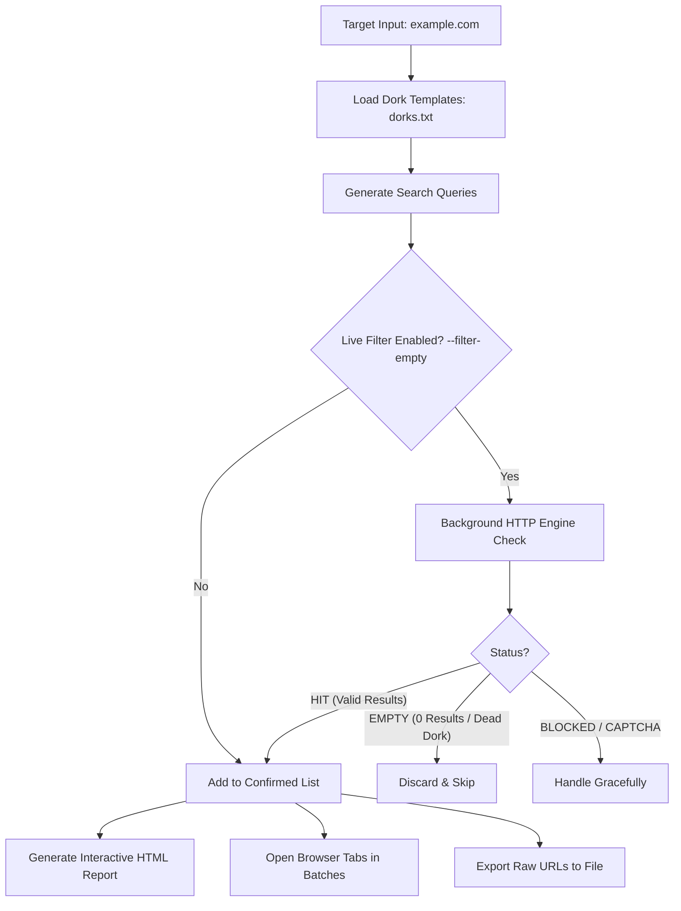

<p align="center">
  
</p>

<h1 align="center">⚡ DorkX — Advanced OSINT Dork Recon & Live Filter</h1>

<p align="center">
  <b>Automated Multi-Engine Reconnaissance Query Generator, Live 0-Result Filter & Interactive Report Generator</b>
</p>

<p align="center">
  
  
  
  
  
</p>

---

## 📌 Overview

**DorkX** is a lightweight, zero-dependency command-line intelligence tool engineered for security researchers, bug bounty hunters, and penetration testers. It automates Google and multi-engine dork reconnaissance across target assets while **actively eliminating false positives**.

Unlike traditional tools that blindly open hundreds of dead browser tabs, **DorkX** features an intelligent **Live Verification Engine** that pre-scans search results in the background, automatically discarding dead dorks that return *"did not match any documents"* (0 matches), and exports only confirmed high-value findings into a sleek, dark-themed interactive HTML report.

```text
  ____             _     __  __
 |  _ \  ___  _ __| | __ \ \/ /
 | | | |/ _ \| '__| |/ /  \  / 
 | |_| | (_) | |  |   <   /  \ 
 |____/ \___/|_|  |_|\_\ /_/\_\  v1.0.0
 Advanced OSINT Dork Recon & Live 0-Result Filter
```

---

## ✨ Key Features

- 🔍 **Live 0-Result Filtering (`--filter-empty`)**: Actively inspects search engine responses to drop queries returning zero documents before opening tabs.
- 🌐 **Multi-Engine Support**: Seamlessly switch between **Google**, **Bing**, **DuckDuckGo**, **Startpage**, and **Yahoo**.
- 📊 **Interactive Dark-Mode HTML Reports (`--html-report`)**: Generates responsive, clickable reports with live counters, query badges, and direct links.
- ⚡ **Zero External Dependencies**: Built entirely with Python's standard library (`urllib`, `dataclasses`, `html`, `webbrowser`). No `pip install` required.
- 🛡️ **Rate-Limit & Bot Protection**: Detects CAPTCHA and HTTP 429 challenges, with customizable request delays and graceful pause/continue controls.
- ⏱️ **Tab Batching & Delay Control**: Prevents browser freezing by opening tabs in batches (e.g. 5 or 10 at a time) with configurable intervals.
- 🎯 **Target Normalization**: Automatically strips protocols (`http://`, `https://`), sub-paths, and ports to ensure clean domain substitution.

---

## 🔄 How It Works



---

## 🚀 Quick Start

### 1. Requirements
- **Python 3.8+** (Windows / Linux / macOS)
- No third-party packages required!

### 2. Basic Recon (Dry-Run Preview)
Inspect generated queries without opening any browser tabs:
```bash
python dorkx.py target.com --dry-run
```

### 3. Filter Dead Dorks & Generate HTML Report *(Recommended)*
Scan target, filter out zero-match queries, and create a styled report:
```bash
python dorkx.py target.com --filter-empty --html-report target_report.html
```

### 4. Open in Controlled Batches
Open verified dorks 5 tabs at a time with a 2-second delay between tabs:
```bash
python dorkx.py target.com --batch-size 5 --delay 2.0
```

---

## 📖 Command-Line Reference

| Flag / Option | Type | Default | Description |
| :--- | :---: | :---: | :--- |
| `domain` | `str` | *Required* | Target domain or URL (e.g., `target.com`, `https://sub.target.com/api`) |
| `-V`, `--filter-empty` | `flag` | `False` | Perform live checks & exclude queries returning *"did not match any documents"* |
| `--html-report <PATH>` | `str` | `None` | Export confirmed matching queries into a styled, clickable HTML report |
| `--export-urls <PATH>` | `str` | `None` | Export clean search URLs line-by-line into a text file |
| `-e`, `--engine <NAME>` | `str` | `google` | Search engine to query (`google`, `bing`, `duckduckgo`, `startpage`, `yahoo`) |
| `-f`, `--file <PATH>` | `str` | `dorks.txt`| Custom template file containing dork queries |
| `-p`, `--placeholder <STR>`| `str` | `example.com` | Placeholder string to replace inside dork templates |
| `-d`, `--delay <SEC>` | `float` | `1.5` | Delay in seconds between opening browser tabs |
| `--verify-delay <SEC>` | `float` | `2.0` | Delay in seconds between background verification requests |
| `--max-verify <NUM>` | `int` | `0` (All) | Limit number of queries to verify during live check (e.g. `20`) |
| `-b`, `--batch-size <NUM>` | `int` | `0` (All) | Open dorks in batches of `N` tabs with interactive confirmation prompts |
| `-n`, `--dry-run` | `flag` | `False` | Print prepared queries and URLs to terminal without launching browser |
| `-y`, `--yes` | `flag` | `False` | Skip safety confirmation prompt when opening more than 10 tabs |

---

## 🛠️ Advanced Usage Examples

### 🎯 Multi-Engine Recon
Run queries against **DuckDuckGo** or **Bing**:
```bash
python dorkx.py target.com -e duckduckgo --filter-empty --html-report ddg_results.html
python dorkx.py target.com -e bing -n
```

### ⚡ Fast Triage (Verify First 30 Dorks)
Quickly test the top 30 dorks with 1.5s delay:
```bash
python dorkx.py target.com --filter-empty --max-verify 30 --verify-delay 1.5 --html-report quick_audit.html
```

### 📁 Custom Dork Wordlists
Point to a custom wordlist with custom placeholder:
```bash
python dorkx.py target.com -f my_sensitive_files.txt -p "{TARGET}"
```

---

## 📊 HTML Report Preview

The generated HTML report includes:
- **Dark Mode UI**: Easy on the eyes during long recon sessions.
- **Dynamic Stats Bar**: Real-time stats showing active hits vs. filtered 0-result queries.
- **Copy & Click**: One-click navigation to search results with safe `rel="noopener noreferrer"` attributes.

---

## 📁 Project Structure

```text
learn-hacking/
├── dorkx.py           # Core DorkX engine & CLI executable
├── dorks.txt          # Extensive database of OSINT / Security dork templates
└── README.md          # Project documentation & guide
```

---

## ⚠️ Disclaimer

> [!IMPORTANT]
> **DorkX** is developed strictly for educational purposes, authorized penetration testing, security auditing, and bug bounty research. 
> Always ensure you have proper authorization before testing target infrastructure. The author and contributors assume no liability for misuse.

---

<p align="center">
  Made with ❤️ for the Cybersecurity & OSINT Community
</p>
